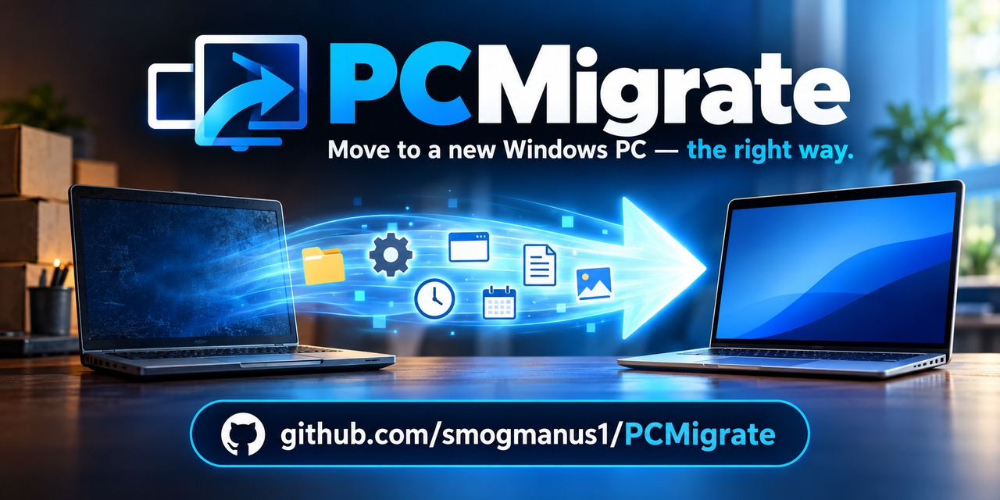
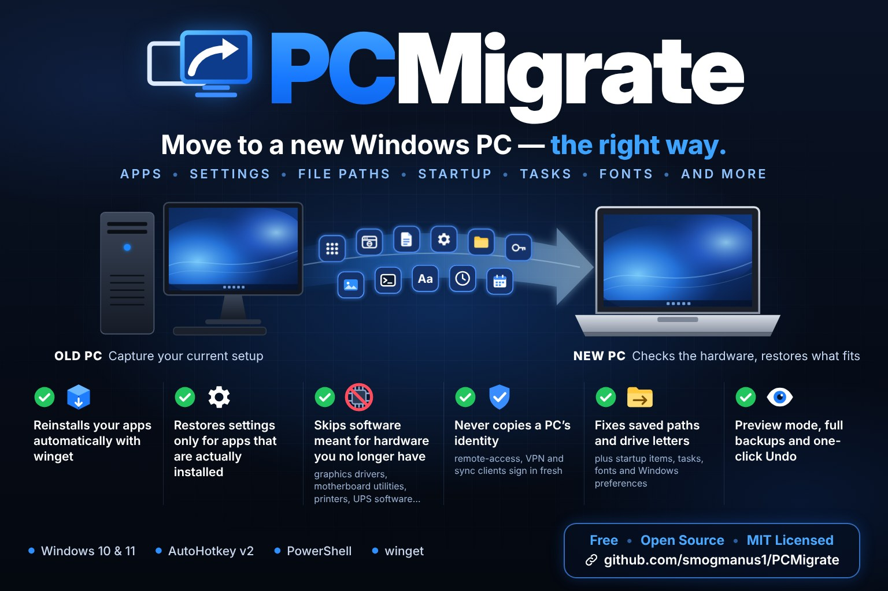

# PCMigrate

**Move your apps and settings from an old Windows PC to a new one, and let the new PC decide what actually fits its hardware.**

Most migration tools copy everything and hope it works. PCMigrate splits the job in two: it captures the old PC, then makes every decision on the new one, where it can see the actual hardware: graphics card, processor, manufacturer, laptop or desktop, and connected devices and printers.

The result is a checklist. Items that fit the new PC are ticked for you, and everything else comes with a plain-English reason, so you always know why.

**Example: moving from a desktop to a laptop**

| From the old PC | What PCMigrate does on the new one |
|---|---|
| Notepad++ and its settings | Installs it and restores your settings |
| AMD Software, Armoury Crate, AURA | Skips them: wrong hardware for this PC |
| HP LaserJet software | Leaves it unticked: printer not connected |
| Tailscale and RustDesk settings | Reinstalls the apps but not their settings, which would clone the old PC's identity |
| `F:\Dropbox` paths saved inside your apps | Maps drive F: so those paths keep working |
| *(nothing)* | Suggests HP Support Assistant and Intel Driver & Support Assistant for this hardware |

*Old PC: AMD Ryzen + Radeon on an ASUS board. New PC: Intel + NVIDIA in an HP ZBook.*

---

## Features




- **Hardware-aware compatibility engine.** Rules check the new PC's GPU, CPU, maker, chassis (laptop/desktop), connected USB devices and printers. Vendor utilities, drivers and peripheral software are only installed where they make sense.
- **Knows what is installed.** Each settings folder and registry key is matched to its program, so settings are restored only for apps that are present, or that are being installed in the same run.
- **Automatic reinstall with winget**, including apps the old PC had installed by hand when winget has them.
- **Never clones machine identity.** Remote-access, VPN and sync clients (Tailscale, RustDesk, TeamViewer, Dropbox, OneDrive...) are reinstalled but their identity settings are not copied.
- **Path fixing.** Finds paths saved inside settings (`F:\Dropbox\...`, `C:\Users\olduser\...`), including JSON-escaped, forward-slash and registry forms. Then either maps the missing drive letter back with a junction (no files moved), or rewrites the paths in text settings files.
- **Windows preferences.** File Explorer options, dark/light mode, keyboard and mouse, relocated Documents/Desktop folders, environment variables and PATH, startup items, your own scheduled tasks, added fonts, Windows Terminal settings, PowerShell profiles, `.gitconfig`, optional Wi-Fi networks and mapped network drives.
- **Suggestions for the new hardware.** For example HP Support Assistant on an HP, Dell Command Update on a Dell, Intel Driver & Support Assistant on Intel systems.
- **Safe by design.** A preview mode that changes nothing; a System Restore point; a backup of everything that gets replaced; a journal of every change; and a one-click **Undo**.
- **Readable report.** A self-contained HTML report of the plan and the results.
- **Editable rules.** All the hardware knowledge lives in [`rules/compat-rules.json`](rules/compat-rules.json). Add your own in a minute ([docs/RULES.md](docs/RULES.md)).

## Requirements

- Windows 10 or 11, Windows PowerShell 5.1 (built in)
- [AutoHotkey v2](https://www.autohotkey.com/) for the launcher (optional; the PowerShell scripts run on their own)
- [winget](https://learn.microsoft.com/windows/package-manager/winget/) (App Installer, built into current Windows) for automatic app installs
- Administrator rights on the new PC

## Quick start

**1. Put the `PCMigrate` folder somewhere both PCs can reach.** A synced folder is easiest, for example `Dropbox\Migration\PCMigrate`. Packages are created next to the `PCMigrate` folder (`Dropbox\Migration\`), so they appear on the new PC by themselves. A USB drive works too.

**2. On the old PC:** optionally click **0. Update all apps first**, then restart, so the captured settings match the versions the new PC will install. Then click **1. Capture this PC**. Close your browsers and other apps first. Capturing changes nothing on the old PC.

**3. On the new PC** (signed in as the user you are moving to): run `PCMigrate.ahk`.
- Optional: click **Preview only** to get the report without changing anything.
- Click **2. Restore onto this PC**, approve the admin prompt, review the checklist, and click **Restore selected**.

**4. Restart** if a drive was mapped, or sign out and back in.

Changed your mind? **3. Undo last restore** puts back everything that restore changed.

> **Tip:** if double-clicking `PCMigrate.ahk` says *"This app can't run on your PC"*, Windows' `.ahk` file association is broken. Right-click the file > **Open with** > **Choose an app on your PC** > `C:\Program Files\AutoHotkey\v2\AutoHotkey64.exe` > **Always**.

Without AutoHotkey:
```powershell
# old PC
powershell -ExecutionPolicy Bypass -File .\src\Capture.ps1
# new PC (as administrator)
powershell -ExecutionPolicy Bypass -STA -File .\src\Restore.ps1
powershell -ExecutionPolicy Bypass -File .\src\Restore.ps1 -WhatIf      # preview / report only
powershell -ExecutionPolicy Bypass -File .\src\Restore.ps1 -Unattended  # apply the recommended selection
powershell -ExecutionPolicy Bypass -File .\src\Undo.ps1
```

## How the checklist decides

| Status | Meaning | Ticked by default |
|---|---|---|
| Will install | winget can install it and it fits this PC | yes |
| App installed here / App installs first | Settings for an app that is (or will be) on this PC | yes |
| Shared settings | Small settings used by Windows or several apps | yes |
| Recommended | Windows preferences, path fixes, fonts | yes |
| Suggested | A tool made for this PC's hardware | yes |
| Install by hand | Not in winget: goes on a printed checklist with the publisher's website | yes |
| Optional | Your call (e.g. a second antivirus, network drives) | no |
| Device not found | Needs a printer/scanner/UPS/mouse that isn't connected right now | no |
| Wrong hardware | Needs hardware this PC doesn't have (other GPU, CPU, maker, desktop-only) | no |
| Not recommended | Machine identity, adware, Windows internals, drivers for the old PC | no |
| App not installed | Settings for an app that isn't on this PC | no |
| Leftover / portable | No matching program on either PC | no |
| Retired | On your personal "never bring this along" list in `PCMigrate.ini` | no |

Everything stays your choice: you can tick or untick anything before restoring.

## What is captured

| Area | Details |
|---|---|
| System profile | Maker, model, board, chassis, CPU, GPU, RAM, OS, drives, printers, connected devices, Dropbox/OneDrive locations, known-folder locations |
| Programs | Full Programs & Features list, Store apps, winget reinstall list, and the apps winget can't reinstall |
| App settings | `%APPDATA%` (minus caches and machine-bound encryption folders), chosen `%LOCALAPPDATA%` folders, one `.reg` file per vendor under `HKCU\Software` |
| Windows | Explorer options, theme/accent, keyboard, mouse, known folders, user environment variables, startup items, your own scheduled tasks, mapped drives, custom hosts entries |
| Files | Added fonts, `.gitconfig`, `.wslconfig`, PowerShell profiles, Windows Terminal settings (skipped if already in Dropbox/OneDrive) |
| Optional | Wi-Fi networks with passwords (`IncludeWifi=1`), `.ssh` folder (`IncludeSsh=1`) |

**Not moved, on purpose:** your documents and media (use your sync service or copy them; relocated Documents/Desktop folders *are* pointed to the same place), saved passwords and credentials (encrypted to the old PC; sign in again or use your password manager), drivers (the new PC needs its own), licences (have your keys ready; the report marks licensed apps).

## Safety

- **Preview mode** writes the report and changes nothing.
- A **System Restore point** is created before changes (if System Restore is on).
- **Every folder, file, registry key and value is backed up** before it is replaced, under `%USERPROFILE%\PCMigrate\Restores\<time>\`.
- **Undo** reverses changes in reverse order from the journal. Installed apps are listed, not uninstalled.
- PCMigrate refuses to run if the admin prompt was approved with a *different* account than the signed-in user, so settings never land in the wrong profile.
- Packages can contain personal data (app settings, optionally Wi-Fi passwords). Keep them private and delete them when you're done.

## Customising

- **`PCMigrate.ini`:** package location, Retired apps, what to skip, extra `LocalAppData` folders, restore point on/off.
- **`rules/compat-rules.json`:** hardware rules, aliases (settings folder → program), identity/adware lists, winget alternatives, suggestions. See [docs/RULES.md](docs/RULES.md).

Rule contributions are very welcome. If PCMigrate gets something wrong for your hardware, a rule usually fixes it for everyone.

## Credits

PCMigrate was conceived, directed and tested by **Brad Schrunk**, and designed and written together with **Claude**, an AI model by **Anthropic**.

## License

[MIT](LICENSE). Use at your own risk: preview first, and keep a backup of anything you can't afford to lose.
